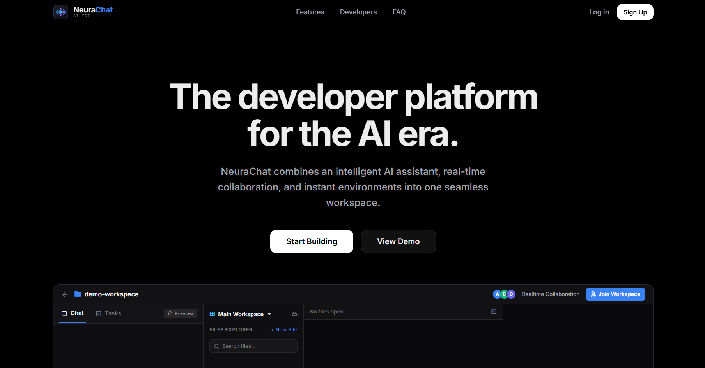
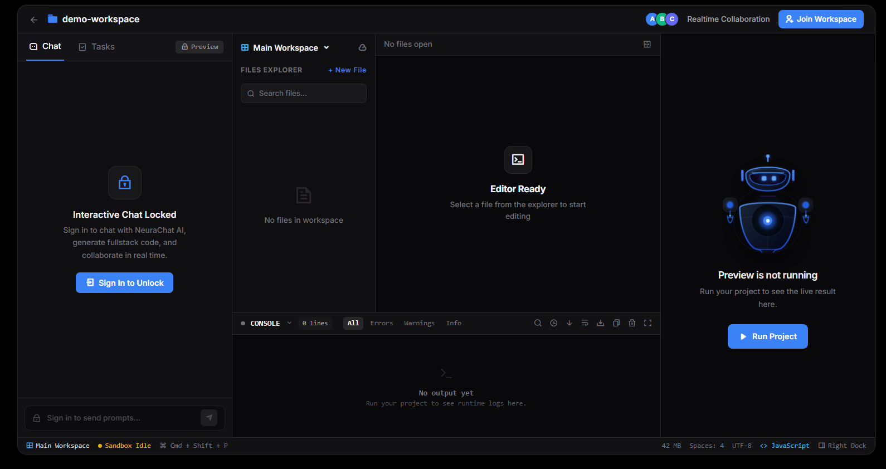
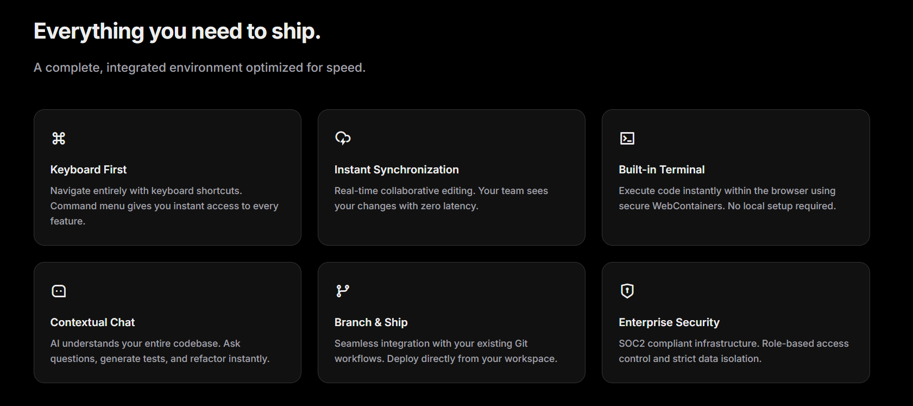
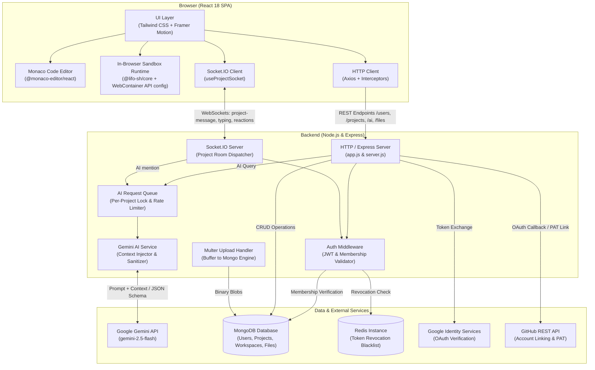

<div align="center">

# NeuraChat

**An AI-powered collaborative development environment in your browser.**

NeuraChat integrates full-stack code authoring, sandboxed in-browser execution, real-time multi-user synchronization, and context-aware LLM code generation into a single web-based workspace.

[](https://neura-chat-omega.vercel.app/home)
[](https://nodejs.org/)
[](https://react.dev/)
[](https://ai.google.dev/)
[](LICENSE)

<p align="center">
  <a href="https://neura-chat-omega.vercel.app/home"><strong>Live Demo</strong></a> •
  <a href="https://github.com/manish23092003/Neura-Chat"><strong>Source Code</strong></a> •
  <a href="https://github.com/manish23092003/Neura-Chat/issues"><strong>Report an Issue</strong></a>
</p>

</div>

---

## Overview

Modern web software development often requires configuring local toolchains, installing language runtimes, synchronizing environment configurations across teams, and switching contexts between AI assistants and local IDEs.

**NeuraChat** addresses this friction by providing a self-contained browser development platform that combines:

1. **Context-Enriched AI Pair Programming:** Direct integration with Google Gemini (`gemini-2.5-flash`), injecting full workspace file trees, active files, and attachments into prompts to generate valid multi-file updates.
2. **In-Browser Execution & Live Preview:** Local-like runtime powered by `@lifo-sh/core` (with `@webcontainer/api` architectural foundation), mounting an in-memory virtual filesystem to install dependencies, run scripts, and preview responsive web interfaces.
3. **Low-Latency Multi-User Collaboration:** Socket.IO room-based event synchronization for real-time team messaging, message reactions, typing status, and concurrent workspace state updates.
4. **Hardened Production Security:** Audited authorization architecture eliminating IDOR vulnerabilities, enforcing socket-level room membership, sanitizing file tree paths, and rate-limiting AI and authentication routes.

---

## Inside NeuraChat

### Modern Landing & Workspace Portal

*A unified workspace for AI-assisted development.*

<br />

### Integrated Development Environment

*Chat, edit files, inspect console output, and preview projects in one workspace.*

<br />

### Platform Architecture & Core Capabilities

*A closer look at the platform's core capabilities.*

---

## Feature Highlights

### AI-Assisted Development (Google Gemini)
- **Model Integration:** Powered by `gemini-2.5-flash` with strict JSON schema response enforcement.
- **Context-Aware Prompts:** The backend automatically traverses workspace directory trees and attaches file contents to user prompts before invoking Gemini.
- **File Attachment Parsing:** Extracts and parses uploaded code and text files (up to 50,000 characters) to ground model generation.
- **In-Memory Response Caching:** SHA-256 hashed prompt caching with a 10-minute TTL to reduce redundant LLM calls and latency.
- **Automated Directory Sanitization:** Traversal guard (`sanitizeFileTree`) blocks relative escapes (`..`), drive prefixes, and path injections before saving generated trees.

### In-Browser Code Editing (Monaco Editor)
- **VS Code Engine:** Embedded `@monaco-editor/react` with IntelliSense, multi-file tab navigation, syntax highlighting, and customizable editor settings.
- **Command Palette:** Keyboard-driven navigation (`Ctrl + Shift + P` for command palette, `Ctrl + P` for quick file open, `Ctrl + B` for workspace sidebar).
- **Hierarchical File Explorer:** Create, rename, view, and delete nested files and folders in real time.

### Sandboxed Runtime & Responsive Live Preview
- **In-Memory Sandbox Runtime:** Leverages `@lifo-sh/core` to boot an isolated `/app` workspace directly inside the browser.
- **Virtual File System Sync:** Synchronizes editor file trees into the sandbox VFS with batch writes.
- **Device Viewport Emulation:** Responsive preview toolbar with presets for Desktop, Laptop, Tablet, and Mobile, plus zoom scaling (`fit`, `50%`, `75%`, `100%`, `125%`).
- **Integrated Terminal Stream:** Captures sandbox stdout/stderr with auto-detected log levels (info, success, warning, error).

### Real-Time Team Collaboration (Socket.IO)
- **Project Rooms:** Scoped WebSocket rooms authenticated via JWT and verified against MongoDB project membership records during the handshake.
- **Live Event Synchronization:** Broadcasts code modifications, chat messages, file uploads, member typing indicators, and message emoji reactions.
- **Shareable Invite System:** Tokenized invite links with public metadata preview and 7-day expiration for rapid onboarding.

### Authentication & Project Persistence
- **Dual Authentication:** Native email/password authentication using bcrypt hashing and JWT tokens, alongside Google OAuth (GIS) integration.
- **Session Revocation:** Redis-backed token blacklist for immediate logout and account deletion revocation, with fail-safe database fallback.
- **Multi-Workspace Organization:** Projects can house multiple independent workspaces, supporting pinning, archiving, and version snapshots.
- **Workspace ZIP Export:** Client-side project bundling via `jszip` allows instantaneous one-click downloading of the complete workspace tree.

---

## System Architecture

The following diagram illustrates the verified relationships between NeuraChat's client, backend services, external APIs, and storage layers:



---

## Technology Stack

| Domain | Technology | Purpose |
|---|---|---|
| **Frontend Framework** | React 18, React Router v7 | Single-page application architecture and client-side routing |
| **Build & Tooling** | Vite 6, PostCSS, Tailwind CSS 3 | Fast development server, bundling, code splitting, and styling |
| **Code Editor** | Monaco Editor (`@monaco-editor/react`) | In-browser code editing, syntax highlighting, and keyboard shortcuts |
| **In-Browser Runtime** | `@lifo-sh/core`, `@webcontainer/api` | Sandboxed browser execution, virtual filesystem management, and live preview |
| **Backend Framework** | Node.js (ES Modules), Express 4.21 | RESTful API server, middleware pipeline, and route dispatching |
| **Real-Time Communication** | Socket.IO (v4.8 Client & Server) | WebSocket room-based messaging, typing indicators, and reactions |
| **AI Integration** | Google Generative AI (`@google/generative-ai`) | Code generation using `gemini-2.5-flash` with JSON output schemas |
| **Database** | MongoDB & Mongoose 8.8 | Persistence for users, projects, workspaces, messages, and uploaded files |
| **Caching & Invalidation** | Redis (`ioredis` 5.4) | Token revocation blacklist on logout, with degraded fallback mode |
| **Authentication & Security** | JWT, bcrypt, Google Auth Library, Helmet | Password hashing, token validation, OAuth verification, and CSP headers |
| **Traffic Control & Utilities** | Express Rate Limit, Multer, JSZip, Axios | IP/user rate limiting, multi-part uploads, ZIP archiving, and HTTP requests |

---

## Project Structure

```
NeuraChat/
├── backend/
│   ├── config/
│   │   └── multer.config.js          # Multer memory storage configuration
│   ├── controllers/
│   │   ├── ai.controller.js           # REST AI prompt generation handler
│   │   ├── file.controller.js         # File upload and download handlers
│   │   ├── github.controller.js       # GitHub OAuth callback and PAT linking
│   │   ├── project.controller.js      # Project & workspace CRUD, tasks, invites
│   │   └── user.controller.js         # User registration, login, profile, Google auth
│   ├── db/
│   │   └── db.js                      # Mongoose connection management
│   ├── middleware/
│   │   └── auth.middleware.js         # JWT verification & Redis blacklist check
│   ├── models/
│   │   ├── file.model.js              # Binary file document schema
│   │   ├── message.model.js           # Chat message & reaction document schema
│   │   ├── project.model.js           # Project, workspace, task, & role schema
│   │   └── user.model.js              # User account & GitHub credential schema
│   ├── routes/
│   │   ├── ai.routes.js               # /ai route definitions
│   │   ├── file.routes.js             # /files upload and download routes
│   │   ├── github.routes.js           # /github integration routes
│   │   ├── project.routes.js          # /projects management routes
│   │   └── user.routes.js             # /users authentication routes
│   ├── services/
│   │   ├── ai.service.js              # Gemini API client, caching, fileTree parsing
│   │   ├── project.service.js         # Project business logic
│   │   ├── redis.service.js           # ioredis client with TLS and reconnect handling
│   │   └── user.service.js            # User management logic
│   ├── tests/
│   │   └── security/
│   │       └── security.test.js       # Automated security regression test suite
│   ├── app.js                         # Express application setup, security, rate limiters
│   ├── server.js                      # HTTP server, Socket.IO handlers, AI queue
│   ├── package.json                   # Backend dependencies and scripts
│   └── .env.example                   # Backend environment template
├── docs/
│   └── screenshots/
│       ├── features-overview.png      # Platform capabilities & architectural preview
│       ├── landing-page.png           # Hero interface introduction
│       └── workspace-editor.png       # Integrated IDE, chat, and live preview
├── frontend/
│   ├── public/                        # Static icons, manifest, service worker
│   ├── src/
│   │   ├── assets/                    # Application graphics and UI textures
│   │   ├── components/
│   │   │   ├── project/               # Workspace IDE components: CodeEditor, LivePreview,
│   │   │   │                          # ChatPanel, FileExplorer, ActivityPanel, StatusBar
│   │   │   └── ui/                    # Reusable primitives: Button, Modal, Navbar, etc.
│   │   ├── config/
│   │   │   ├── axios.js               # Axios instance with credentials and base URL
│   │   │   ├── lifoRuntime.js         # Lifo sandbox creation, VFS sync, runner
│   │   │   ├── socket.js              # Socket.IO client initialization
│   │   │   └── webContainer.js        # WebContainer boot loader instance
│   │   ├── context/
│   │   │   └── user.context.jsx       # Global user authentication context provider
│   │   ├── hooks/
│   │   │   ├── useFileTree.js         # Workspace file tree mutations and state
│   │   │   ├── useLifoRuntime.js      # Sandbox execution state and terminal logs
│   │   │   └── useProjectSocket.js    # WebSocket event binding and message state
│   │   ├── screens/
│   │   │   ├── Home.jsx               # User project management dashboard
│   │   │   ├── JoinProject.jsx        # Invite token landing and join screen
│   │   │   ├── Landing.jsx            # Product landing page and feature highlights
│   │   │   ├── Login.jsx              # User login screen with Google OAuth
│   │   │   ├── Profile.jsx            # User profile and GitHub connection settings
│   │   │   ├── Project.jsx            # Core collaborative IDE and workspace
│   │   │   └── Register.jsx           # User registration screen
│   │   ├── App.jsx                    # Route hierarchy and context wrappers
│   │   ├── main.jsx                   # React DOM root entry point
│   │   └── index.css                  # Global design tokens and Tailwind directives
│   ├── vite.config.js                 # Vite build optimization and manual chunk splitting
│   ├── package.json                   # Frontend dependencies and scripts
│   └── .env.example                   # Frontend environment template
├── LICENSE                            # ISC open-source license terms
├── SECURITY_AUDIT.md                  # Comprehensive vulnerability audit documentation
├── SECURITY_HARDENING_REPORT.md       # Audit remediation verification and test matrix
└── README.md
```

---

## Getting Started

Follow these steps to set up and run NeuraChat in a local development environment.

### Prerequisites
- **Node.js**: v18.0.0 or higher
- **npm**: v9.0.0 or higher
- **MongoDB**: Local MongoDB instance (`mongodb://localhost:27017`) or MongoDB Atlas connection string
- **Redis** *(Optional but recommended)*: Local Redis instance (`127.0.0.1:6379`) or Upstash Redis URL (the backend operates gracefully in degraded mode if Redis is unavailable)
- **Google Gemini API Key**: Obtain a key from [Google AI Studio](https://aistudio.google.com/)

---

### 1. Clone the Repository

```bash
git clone https://github.com/manish23092003/Neura-Chat.git
cd Neura-Chat
```

---

### 2. Configure and Start the Backend

```bash
cd backend
npm install
```

Create a `.env` configuration file inside `backend/` based on `.env.example`:

```bash
cp .env.example .env
```

Populate the required environment variables:

```ini
# Database Connection
MONGODB_URI=mongodb://localhost:27017/neurachat_db
REDIS_HOST=127.0.0.1
REDIS_PORT=6379

# Authentication
JWT_SECRET=your_development_jwt_secret_key_minimum_32_characters

# AI Integration
GOOGLE_API_KEY=your_gemini_api_key_from_google_ai_studio

# OAuth Credentials (Optional for local testing)
GOOGLE_CLIENT_ID=your_google_oauth_client_id
GITHUB_CLIENT_ID=your_github_oauth_client_id
GITHUB_CLIENT_SECRET=your_github_oauth_client_secret

# Network Configuration
PORT=5000
NODE_ENV=development
FRONTEND_URL=http://localhost:5173
```

Start the backend development server (with nodemon):

```bash
npm run dev
```

The backend server will start on `http://localhost:5000`. You can verify its health at `http://localhost:5000/health`.

---

### 3. Configure and Start the Frontend

Open a new terminal session and navigate to the `frontend/` directory:

```bash
cd frontend
npm install
```

Create a `.env` configuration file inside `frontend/` based on `.env.example`:

```bash
cp .env.example .env
```

Populate the frontend environment variables:

```ini
# Backend API Base URL
VITE_API_URL=http://localhost:5000

# OAuth Integrations (Optional for local development)
VITE_GITHUB_CLIENT_ID=your_github_oauth_client_id
VITE_GOOGLE_CLIENT_ID=your_google_oauth_client_id
```

Start the Vite development server:

```bash
npm run dev
```

The application will be accessible at `http://localhost:5173`.

---

## API & Real-Time Specifications

### REST API Endpoints

#### Authentication & User Management (`/users`)
| Method | Endpoint | Description | Auth Required |
|---|---|---|:---:|
| `POST` | `/users/register` | Register a new user with email and password | No |
| `POST` | `/users/login` | Authenticate existing user; returns JWT & HttpOnly cookie | No |
| `POST` | `/users/google-auth` | Authenticate with Google ID credential | No |
| `GET` | `/users/profile` | Retrieve profile information for the authenticated user | Yes |
| `PUT` | `/users/profile` | Update profile information (name, avatar) | Yes |
| `PUT` | `/users/change-password` | Update account password | Yes |
| `DELETE`| `/users/profile` | Delete user account and revoke active tokens | Yes |
| `GET` | `/users/logout` | Revoke current JWT token via Redis blacklist | Yes |
| `GET` | `/users/all` | Search and list platform users for project invitations | Yes |

#### Project & Workspace Management (`/projects`)
| Method | Endpoint | Description | Auth Required |
|---|---|---|:---:|
| `POST` | `/projects/create` | Create a new project | Yes |
| `GET` | `/projects/all` | List all projects belonging to the authenticated user | Yes |
| `GET` | `/projects/get-project/:projectId` | Retrieve detailed project metadata and active workspaces | Yes |
| `GET` | `/projects/get-messages/:projectId` | Fetch historical chat messages for a project room | Yes |
| `PUT` | `/projects/update-file-tree` | Synchronize modified workspace file tree to MongoDB | Yes |
| `PUT` | `/projects/add-user` | Add collaborator IDs to a project | Yes |
| `DELETE`| `/projects/:projectId` | Delete a project and associated workspaces | Yes |
| `POST` | `/projects/:projectId/workspaces` | Create a new isolated workspace within a project | Yes |
| `PUT` | `/projects/:projectId/workspaces/:workspaceId` | Update workspace metadata or pinned status | Yes |
| `DELETE`| `/projects/:projectId/workspaces/:workspaceId` | Remove a workspace subdocument | Yes |
| `POST` | `/projects/:projectId/tasks` | Create a new tracking task within a project | Yes |
| `PUT` | `/projects/:projectId/tasks/:taskId/toggle` | Toggle task completion state | Yes |
| `POST` | `/projects/:projectId/invite/generate` | Generate a 7-day shareable project invite token | Yes |
| `GET` | `/projects/invite/:token/preview` | Public preview of project name and member count | No |
| `POST` | `/projects/invite/join` | Join a project using a valid invite token | Yes |

#### AI Generation & Files (`/ai`, `/files`, `/github`)
| Method | Endpoint | Description | Auth Required |
|---|---|---|:---:|
| `GET` | `/ai/get-result` | Query Google Gemini with prompt (rate-limited) | Yes |
| `POST` | `/files/upload` | Multipart file upload (max 10 files, stored in MongoDB) | Yes |
| `GET` | `/files/:filename` | Stream uploaded binary file with nosniff headers | No |
| `GET` | `/github/callback` | OAuth redirect callback for GitHub account linking | No |
| `POST` | `/github/link-token` | Connect GitHub account via Personal Access Token | Yes |
| `POST` | `/github/disconnect` | Disconnect linked GitHub account | Yes |

---

### Socket.IO Real-Time Events

All Socket.IO connections require a valid JWT token in handshake authentication (`auth.token` or `Authorization` header) and a valid `projectId` query parameter. The server verifies that the authenticated user is an authorized project member before admitting the socket to the room.

| Event Name | Direction | Payload Structure | Purpose |
|---|:---:|---|---|
| `project-message` | Client -> Server | `{ _id, message, workspaceId, workspaceFileTree }` | Dispatches user chat messages. Triggers Gemini AI generation if message contains `@ai`. |
| `project-message` | Server -> Client | `{ _id, message, sender, workspaceId, timestamp, reactions }` | Broadcasts user messages or AI-generated fileTree responses to all room peers. |
| `project-file-message` | Client -> Server | `{ _id, message, files, workspaceId, workspaceFileTree }` | Shares uploaded file references with project peers. |
| `project-file-message` | Server -> Client | `{ _id, message, sender, files, workspaceId, timestamp }` | Broadcasts file attachments to project collaborators. |
| `message-reaction` | Bidirectional | `{ messageId, emoji, user, reactions }` | Synchronizes emoji reactions on chat messages. |
| `user-typing` | Client -> Server | `{ user, typing: boolean }` | Emits current user typing activity. |
| `user-typing-start` | Server -> Client | `{ user }` | Notifies clients that a collaborator is typing. |
| `user-typing-stop` | Server -> Client | `{ user }` | Notifies clients that a collaborator has stopped typing. |

---

## Security Architecture & Hardening

NeuraChat's codebase has undergone extensive security hardening and verification, documented in detail in [SECURITY_AUDIT.md](SECURITY_AUDIT.md) and [SECURITY_HARDENING_REPORT.md](SECURITY_HARDENING_REPORT.md):

1. **Authorization & IDOR Protection:** Every project and workspace endpoint strictly verifies server-side membership (`project.users.includes(userId)`). Unauthorized requests are rejected with `403 Forbidden`.
2. **WebSocket Room Isolation:** Handshake verification ensures that malicious users cannot listen to or emit messages into unauthorized project rooms.
3. **AI Generation Guardrails:**
   - Endpoint protected by authentication middleware.
   - Enforces dual rate limiting (per-user window limiting to 10 requests/minute and per-IP limiter at 30 requests/minute).
   - Per-project serialization queue prevents race conditions and resource starvation.
   - Directory traversal filter (`sanitizeFileTree`) inspects all AI-generated keys to prevent path traversal outside the project directory.
4. **Header Hardening & CSP:** Configured using `helmet` with Content Security Policies supporting Monaco web workers, Google OAuth popups, and secure iframes.
5. **Session Revocation:** Redis blacklist ensures tokens are immediately invalidated upon logout or account deletion.

---

## Roadmap

Planned capabilities and technical milestones under consideration:

- [ ] **Collaborative Monaco Cursor Synchronization:** Real-time multi-cursor editing using CRDT protocols (Yjs / Automerge) over WebSockets.
- [ ] **WebContainer Terminal PTY Multiplexing:** Expanded terminal session management with interactive xterm.js emulation.
- [ ] **Git Version Control & Branching:** In-browser Git porcelain operations (commit, branch, push, pull) using isomorphic-git.
- [ ] **Automated Cloud Deployments:** One-click deployment integrations targeting Vercel, Netlify, and Docker container hosts.
- [ ] **Agentic AI Tool Execution:** Structured AI tool calling allowing Gemini to execute commands, lint code, and fix build failures autonomously.

---

## Contributing

Contributions are welcome. Please adhere to the following workflow:

1. **Fork** the repository and create a feature branch:
   ```bash
   git checkout -b feature/your-feature-name
   ```
2. Ensure your changes follow existing code conventions and pass all security audits:
   ```bash
   cd backend && node tests/security/security.test.js
   ```
3. Commit your changes with concise, descriptive commit messages:
   ```bash
   git commit -m "feat: add support for custom workspace port mappings"
   ```
4. Push to your branch and submit a **Pull Request** detailing the problem addressed and implementation details.

---

## License

This project is open-source under the [ISC License](LICENSE).  
See the [LICENSE](LICENSE) file for the complete license terms.

---

## Author

**Manish Soni**  
- **GitHub:** [@manish23092003](https://github.com/manish23092003)  
- **LinkedIn:** [Manish Soni](https://www.linkedin.com/in/manish-soni-089357245)
